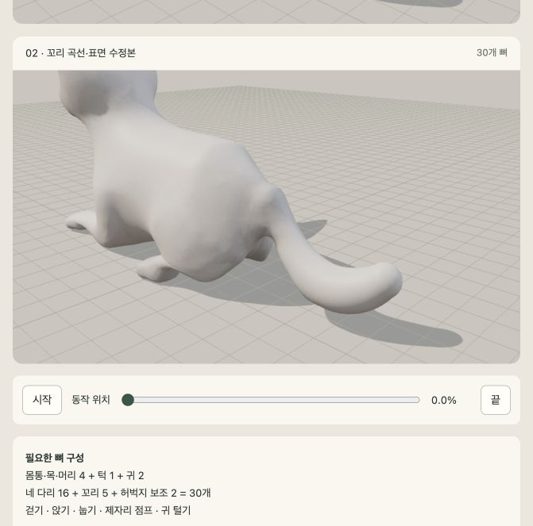
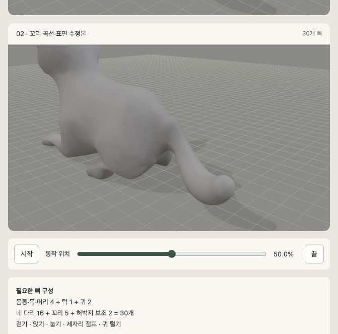

# Snowdrop 꼬리 끝 음영 정리

2026-11-18. 꼬리 끝에 남은 선과 방향에 따라 나타나던 음영 경계를 정리했다.

## 원인과 수정

Blender에서 색상 단독·노멀맵 제외·단색 렌더를 비교했다. 원본 색상 텍스처에 꼬리 끝을 두르는 선이 있었고, 웹에서 재질을 분리하자 반사율 맵에도 같은 경계가 드러났다. 흰 털 끝의 금속성 값은 최대 0.302였으며 거칠기도 주변과 달랐다.

Blender의 UV 위치 마스크로 꼬리 끝 전체와 전환 영역만 보정했다. 주변 흰 털의 중간 색상에 미세한 색상 변화를 남기고 잘못 그려진 음영을 제거했다. 거칠기는 주변 중간값인 0.533에 맞췄으며 금속성은 0으로 정리했다. 노멀맵은 보존했다.

색상 맵 253,842픽셀, 재질 맵 212,312픽셀을 수정했다. UV 여백을 포함한 값이다. 저장한 PNG를 다시 읽어 보정 영역 밖의 픽셀이 동일함을 검사했다. 메시 좌표·노멀·UV·가중치·뼈·보정 형상·모든 동작 데이터는 직전 `snowdrop-tail-smooth.glb`와 바이트 단위로 동일하다.

## 파일과 재생성

- 적용본: `public/models/characters/snowdrop/snowdrop-tail-clean.glb`
- 편집본: `public/models/characters/snowdrop/snowdrop-tail-clean.blend`
- 생성 기록: `public/models/characters/snowdrop/snowdrop-tail-clean-build.json`
- 비교 화면: `/snowdrop-review.html?compare=rest`
- 검수 화면: `docs/cat-reference/tail-tip-review/`

```sh
blender --background --factory-startup --disable-autoexec --python-exit-code 1 --python scripts/clean-snowdrop-tail-tip.py
node scripts/check-snowdrop-rest.mjs
node scripts/check-cat-motion.ts
npm run build
```

생성 입력과 직전 적용본은 보존했다. `SNOWDROP_MODEL_FILE`을 `snowdrop-tail-smooth.glb`로 바꾸면 직전 버전으로 되돌릴 수 있다.

## 검증

꼬리 끝 색상 대비의 0.1~99.9백분위 범위가 0.259에서 0.00784로 줄었다. 생성 스크립트는 보정 밖 픽셀 보존, 색상·거칠기 경계와 잘못된 금속성 값을 검사한다. 원본은 같은 색상 대비 및 금속성 기준을 통과하지 못한다.

휴식 자세·꼬리 단면·접지·기존 동작 보존 검사, 걷기·점프·귀·꼬리·일어서기 후 이동 검사와 빌드가 통과했다. 저장된 Blender 파일에서 뼈 30개, Basis 포함 형상 키 14개, 클립 9개와 텍스처 패킹을 확인했다.

Blender의 꼬리 근접·후면 렌더와 실제 웹의 밝은 조명·그늘, 양쪽 흔들림, 앉기·눕기 및 전환 중간을 확인했다. 밤하우스 거실에서도 X 앉기·C 눕기를 확인했다. 검수한 각도에서 기존 끝부분 경계는 보이지 않았으며 브라우저 콘솔 오류는 없었다. 기존 빌드 청크 크기 경고는 남는다.




