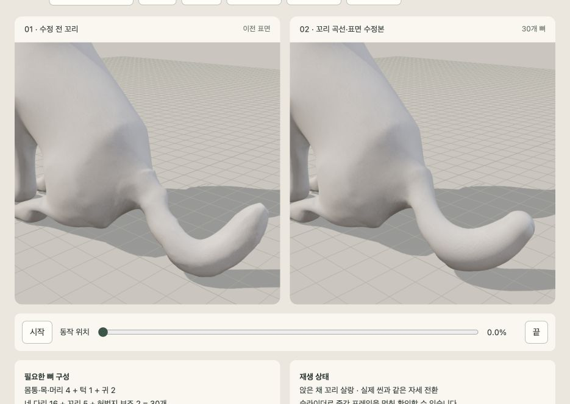
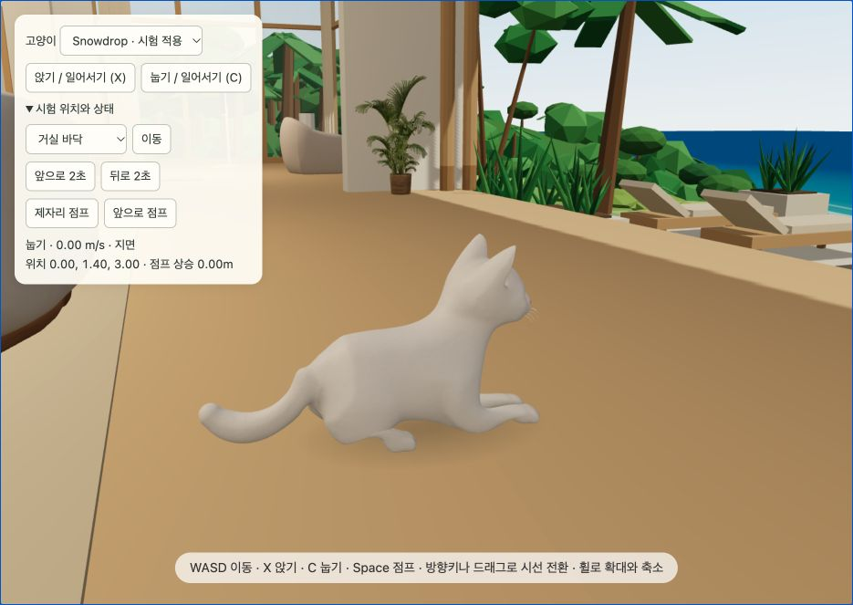

# Snowdrop 꼬리 곡선·표면 수정

이 작업에서 남았던 끝부분 음영 경계는 [꼬리 끝 음영 정리](snowdrop-tail-clean.md)에서 수정했다. 현재 비교 화면은 이 파일과 최종 색상·반사율 보정본을 비교한다.

2026-11-18. 꼬리 전체의 울퉁불퉁한 실루엣과 마디 사이의 꺾임을 줄였다.

## 변경

Blender에서 꼬리 중심 곡선과 단면 반지름을 연속적으로 맞추고 부피를 보존하는 표면 평활화를 적용했다. 메시와 13개 보정 형상의 꼬리 영역을 함께 수정했다. 꼬리 끝은 둥글게 정리하고 노멀 변화도 부드럽게 연결했다.

마디 사이 가중치는 최대 4개 뼈의 연속 곡선으로 연결했다. 뿌리는 골반 중앙에 고정하고 자유롭게 움직이는 마디의 영향이 엉덩이까지 전달되지 않도록 조정했다. 앉기·눕기 중간과 끝 자세의 연결부도 보정했다. 연결부 전체를 수축시키는 방법은 턱을 만들어 제외했고, 눕기의 기존 부피 보정이 과해지는 부분만 낮췄다.

얼굴·몸통·다리의 승인된 형상과 동작, UV·텍스처·토폴로지는 보존했다. 수정 범위는 꼬리와 작은 연결부다. 원본 `snowdrop-rest-paws.glb`의 SHA-256은 생성 전후 동일하다.

## 작업본

- 웹 적용본: `public/models/characters/snowdrop/snowdrop-tail-smooth.glb`
- Blender 편집본: `public/models/characters/snowdrop/snowdrop-tail-smooth.blend`
- 전후 비교: `/snowdrop-review.html?compare=rest`. 왼쪽은 `snowdrop-tail-rooted.glb`, 오른쪽은 수정본이다.
- 근접 확인: `꼬리 가까이` 버튼과 자세 전환의 `앉은 채 꼬리 살랑`·`누운 채 꼬리 살랑`을 사용한다.
- 검수 화면: `docs/cat-reference/tail-smooth-review/`
- 검사 수치: `docs/snowdrop-tail-smooth-validation.json`

```sh
blender --background --factory-startup --disable-autoexec --python-exit-code 1 --python scripts/refine-snowdrop-rest.py -- --tail-only
node scripts/check-snowdrop-rest.mjs
node scripts/check-cat-motion.ts
npm run build
```

기존 자세를 보존하려면 재생성 시 `--tail-only`를 지정한다. 이전 버전은 보존했으며 `SNOWDROP_MODEL_FILE`을 `snowdrop-tail-rooted.glb`로 바꾸면 되돌릴 수 있다.

## 확인 결과

- 표면 노멀의 국소 편차는 이전의 56.3%로 줄었다. 이는 음영의 국소 굴곡을 비교하는 지표이며 외형 품질 전체를 뜻하지 않는다. 정리한 꼬리에서 뒤집힌 삼각형은 0개다.
- 앉기·눕기 각 61개 프레임, 꼬리 흔들림 각 73개 시점과 자세 전환 600프레임을 검사했다. 꼬리 단면 너비는 기준의 0.973~1.099 범위였으며 연결부 최대 이동은 앉기 0.00575, 눕기 0.00198 모델 단위였다.
- 기존 걷기·점프·귀 동작 보존, 좌우 꼬리 흔들림, 루프 연결, 발 접지, 일어서기 후 이동 검사와 빌드가 통과했다. 기존 500kB 초과 청크 경고는 남는다.
- 저장한 Blender 파일을 다시 열어 뼈 30개, Basis 포함 형상 키 14개와 클립 9개를 확인했다. 앞·옆·뒤·사선 렌더를 저장했다.
- 실제 웹에서 앉기·눕기 양쪽 흔들림과 그늘의 전환 중간을 비교했다. 밤하우스 거실에서 X 앉기와 C 눕기를 확인했고 두 화면의 브라우저 콘솔 오류는 없었다. 근접 시 끝부분의 작은 음영 경계는 남아 있다.




