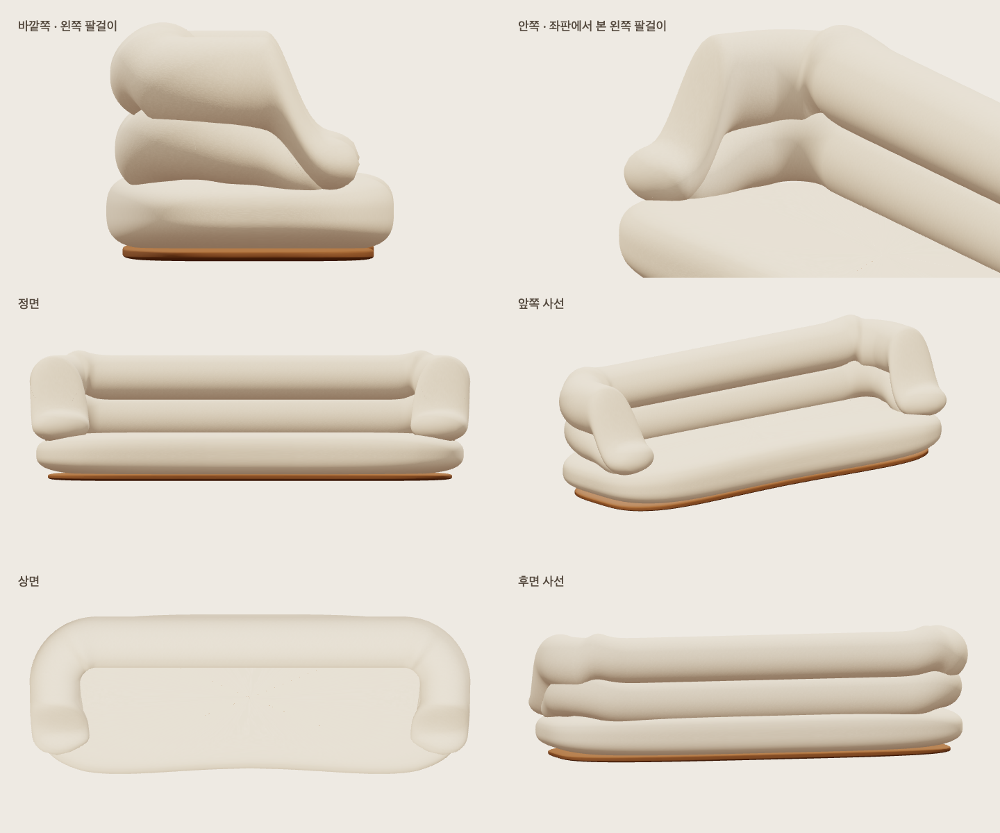

# 밤하우스 아이보리 부클레 소파 3D 설계서

새 후면 사진의 가로 이음선 두 줄과 양끝이 살짝 올라오는 등받이를 기준으로 소파 외형을 모델링했다. 포트폴리오와 웹 3D 뷰어에서 소파를 회전해 볼 수 있도록 쿠션과 주변 가구를 제외했다.

[GLB 파일](../public/models/sofa-cloud-nest-portfolio.glb)

## 참고 자료와 치수

| 자료 | 반영한 특징 |
| --- | --- |
| 사용자가 첨부한 후면 사진 | 가로로 이어지는 세 겹의 볼륨, 끝이 올라오는 상단 윤곽, 얇은 목재 받침 |
| 원본 정면 사선 사진과 생성한 정면·측면 이미지 | 오목한 좌판 앞선, 앞쪽으로 말려 내려가는 팔걸이, 아이보리 부클레 |
| [기존 녹색 Cloud Nest GLB](../public/models/sofa-cloud-nest-green.glb)와 [장면 코드](../src/scene/Interior.tsx) | 장면에서 사용하는 폭과 정면 방향, 배치 방식 |

형상은 같은 좌표계에서 좌우 대칭으로 재구성했다. 사진에서 직접 확인할 수 없는 상면의 곡률과 하부 형상은 이미지 사이의 비례를 바탕으로 추정했다.

| 항목 | 모델 치수 | 근거 |
| --- | ---: | --- |
| 전체 폭 | 4,000mm | 프로젝트 배치 기준값. 실물 폭은 미측정 |
| 전체 깊이 | 1,449mm | 추정. 측면 이미지와 좌판 앞선 기준 |
| 전체 높이 | 1,177mm | 추정. 후면 윤곽에서 양끝 최고점까지 |
| 좌면 중앙 높이 | 약 432mm | 추정. 바닥부터 좌판 윗면까지 |
| 받침 전체 높이 | 약 70mm | 추정. 하부 일부가 좌판에 묻히는 형상 |
| 후면 곡선 경로 반경 | 약 380mm | 추정. 등받이 경로가 팔걸이 방향으로 꺾이는 구간 |
| 등받이 최대 수평 단면 반경 | 약 232mm | 추정. 상단 롤 중앙 기준 |

## 형상과 이음선

- 상단 롤과 중간 롤은 각각 U자로 이어진다. 상단은 뒷모서리에서 살짝 솟고 앞쪽에서는 아래로 내려와 팔걸이 끝을 이룬다. 각 롤은 경로 184구간과 단면 64분할로 샘플링하고 타원형으로 좁아지는 캡으로 닫았다. 경로의 굽힘 반경을 단면 반경보다 크게 잡았다.
- 하단에는 연속 좌판을 두고 중앙 앞선을 최대 약 115mm 뒤로 물렸다. 좌판과 받침은 둘레 192분할과 세로 48구간으로 구성했다. 받침은 좌판 외곽 안으로 들였다.
- 후면 중앙의 두 이음선은 롤과 좌판의 접합부에서 생기는 실제 요철이다. 각 층을 겹쳐 연결하고 UV 경계 정점의 노멀을 평균해 이음선 음영이 연속되도록 했다. 이음부의 곡면 깊이는 사진을 바탕으로 정했다. 실물의 봉제 깊이는 미측정이다.

## 재질과 GLB

| 부위 | 기준색 | Roughness | Normal 강도 | UV 반복 |
| --- | --- | ---: | ---: | --- |
| 부클레 | `#E7DAC4` | 0.92 | 0.36 | 등받이 길이 약 8.9회/m, 단면 12회. 좌판 둘레 62회, 높이 방향 11회 |
| 목재 받침 | `#8B5E38` | 0.70 | 0 | 둘레 62회, 높이 방향 11회 |

두 재질의 Metallic은 0이다. UV는 곡면을 따라 배치했다. 텍스처는 고리 모양의 부클레 요철과 길이 방향의 나뭇결을 절차적으로 생성한 256px PNG다. 색상 맵 두 장과 노멀 맵 한 장을 GLB에 내장했다. 모델은 메시 4개와 삼각형 82,944개로 구성되며 파일 크기는 약 2.08MB다.

## 배치와 검수

- 좌우는 X축, 위는 +Y, 정면은 +Z다. 원점은 바운딩 박스 중심의 바닥 투영점이며 모델 최저점은 Y=0이다.
- 현재 장면을 기준으로 배치 중심은 (1.50, 0, 1.25)m이고 Y축 회전은 180°다. 모델의 투영 외곽은 X −0.50~3.50m, Z 0.526~1.974m로 약 5.80m²를 차지한다. [기존 배치 허용 치수](sofa-model-spec.md)는 4.40 × 1.74 × 1.65m이며, 이 한계 안에서의 최대 균일 배율은 약 1.10이다. 현행 좌우 통로를 유지하는 기준은 폭 4.00m다.
- 내보낸 GLB를 Three.js에서 다시 불러 여섯 시점을 렌더링했다. 크기와 바닥 원점, 퇴화 삼각형 유무, 외관과 텍스처 로드를 확인했다. 프로젝트 빌드와 현재 장면의 동선 검사를 통과했다.
- 거실에 새 GLB를 배치했다. 좌판의 최대 외곽을 착지면으로 쓰고 등받이와 팔걸이는 폭 0.20m 구간별 볼록 외곽과 최고점으로 근사했다.
- 실물 제작 도면에는 실측 치수, 내부 프레임, 폼 사양, 봉제 패턴이 추가로 필요하다.
